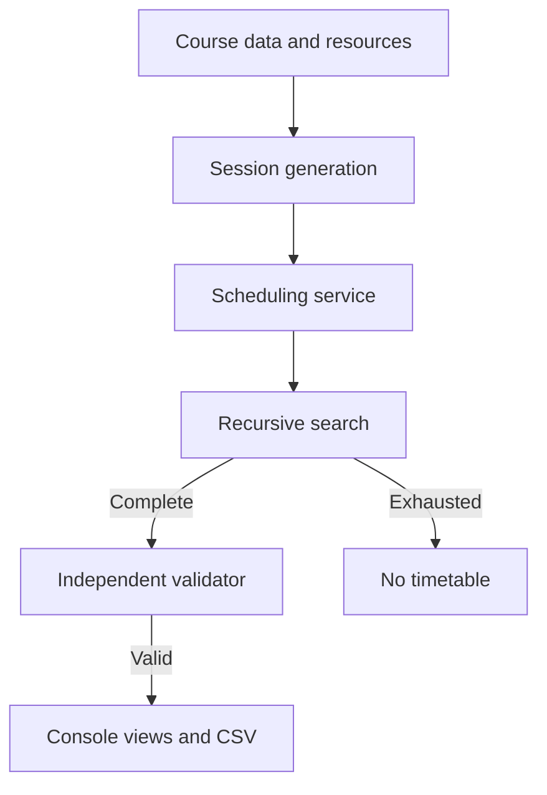

# TimeTableX

**Automated University Timetable Generator and Optimizer**

Mohammad Seraz Alam Raihan · BSSE1746 · Software Project Lab I (SPL-1)

Institute of Information Technology, University of Dhaka · C++17

TimeTableX helps a department coordinator turn course requirements into a weekly timetable. The department assigns each teacher in advance. The scheduler finds a time and room for every required session while enforcing the academic calendar and preventing resource conflicts.

The modular implementation builds on M1–M3. At the start of the refactor, both `main` and `feature/lab-scheduling` pointed to the same working checkpoint, [`8b929d8`](https://github.com/bsse1746-seraz/SPL-1/commit/8b929d8).

## What works

| Area | Current behavior |
| --- | --- |
| Calendar | Sunday–Thursday in 30-minute units. Theory runs within 09:00–13:00, break is 13:00–14:00, and labs run within 14:00–17:00. |
| Courses and credits | Fixed teacher and batch IDs, integer half-credits, and approved session lengths from built-in data or the course CSV. |
| Availability | Checks every occupied half-hour. The built-in demo blocks Teacher A on Sunday 09:00–09:30. The CSV demo starts with unrestricted availability. |
| Conflicts and rooms | Checks overlapping teachers, batches, and rooms. A room must have enough seats. Labs require a computer lab. |
| Scheduling | Handwritten recursive backtracking returns the first valid timetable or reports exhausted search. |
| Validation and output | A separate validator rechecks completed assignments. The CLI shows the full timetable and both batch views and writes `timetable.csv`. |
| Tests | 74 self-checks cover the calendar, conflicts, credit rules, CSV parsing, room rules, and search undo. |

The demonstration policy uses 60 minutes per theory credit and 120 minutes per lab credit. The sample inventory has three teachers, two batches, and two rooms. Example data and contact-hour conversions are project fixtures.

## How scheduling works

Each required session is a CSP variable. Its candidate values are pairs of weekly start slot and room. Calendar windows, availability, capacity, lab suitability, and resource conflicts restrict which pairs can be chosen together. The scheduler tries pairs in order, recurses to the next session, and undoes the current choice if deeper search runs out of options.



See [architecture](docs/ARCHITECTURE.md) for module boundaries and the GUI integration path.

## Build on Windows

Open PowerShell at the repository root. With GCC/MinGW `g++` on your PATH, run these commands.

```powershell
g++ --version
powershell.exe -NoProfile -ExecutionPolicy Bypass -File .\scripts\build.ps1
.\build\timetablex.exe --test
.\build\timetablex.exe --demo-file data/courses.csv
```

The script compiles as C++17 and writes `build/timetablex.exe`. The execution-policy setting applies to this PowerShell process. Double-clicking `scripts/run_windows.bat` builds and opens the interactive menu.

With CMake 3.16+ and a C++17 compiler configured, use the following commands.

```powershell
cmake -S . -B build/cmake
cmake --build build/cmake --config Release
Push-Location build/cmake
ctest -C Release --output-on-failure
Pop-Location
```

CMake creates the `timetablex_core` library and `timetablex` executable. If MinGW is your only Windows toolchain and `mingw32-make` is on PATH, use `cmake -S . -B build/mingw -G "MinGW Makefiles"` and use `build/mingw` in the subsequent commands.

## Run the demos

```powershell
.\build\timetablex.exe
.\build\timetablex.exe --demo
.\build\timetablex.exe --demo-file data/courses.csv
.\build\timetablex.exe --impossible
.\build\timetablex.exe --test
```

The sample CSV produces **nine sessions**, reports **zero hard-constraint violations**, and assigns `C++ Lab` to Room-101 on Sunday 14:00–16:00. A successful run writes `timetable.csv` in the current working directory. An impossible run reports exhausted search and leaves any existing export intact. The test command ends with `74 tests passed.`

### Course CSV

The [sample file](data/courses.csv) uses the header and row format below.

```csv
course,teacher_id,batch_id,theory_half_credits,lab_half_credits,theory_pattern_minutes,lab_pattern_minutes
C++,0,0,4,2,60;60,120
Math,1,0,3,0,90,
```

Teacher IDs are 0–2 for Teachers A–C. Batch IDs 0 and 1 are BSSE-17 and BSSE-18. Four half-credits mean 2.0 credits. Separate durations within a component with semicolons. Leave the pattern field empty for a component with zero credit. The parser expects the exact header and unquoted fields.

## Repository layout

| Path | Role |
| --- | --- |
| `include/timetablex/` | Public headers for models, scheduling, the application service, demo data, and CSV I/O. |
| `src/` | Entry point and module implementations. |
| `tests/` | Self-checks available through `--test` and CTest. |
| `data/` | Sample course requirements. |
| `scripts/`, `.github/workflows/` | Windows build and menu launcher, plus CI configuration. |
| `docs/`, `learnings/` | Architecture, demo, verification, and milestone notes. |

The [refactor notes](docs/REFACTOR_NOTES.md) list the complete tree. The proposal documents and root `code.c` are historical course material. The original monolithic source remains available through the checkpoint in Git history.

## Scope and roadmap

The current search is intended for small demonstration datasets. It chooses the first feasible solution in input order. Classes can cluster early in the week, and repeated sessions can occur on the same day. The input file supplies course data. Availability and resource inventories are still supplied by the demo setup.

M4 covers preference input and scoring. M5 covers search heuristics, optimization, and performance evaluation. A future GUI can prepare a `Problem`, call `SchedulingService::generate`, and display its result. See the [roadmap](docs/ROADMAP.md), [midterm demo and viva guide](docs/MIDTERM_DEMO.md), and [learning notes](learnings/README.md).
