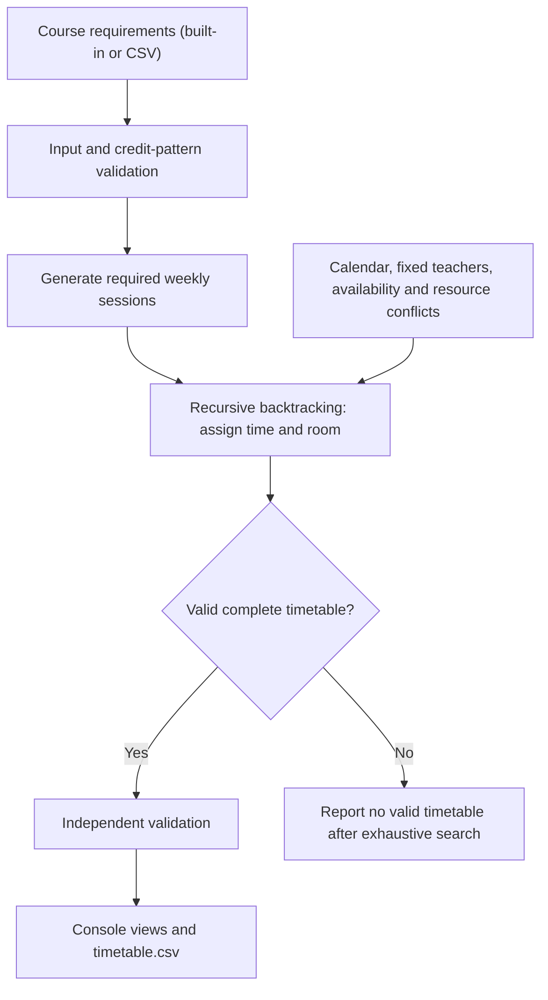

# TimeTableX

### Automated University Timetable Generator and Optimizer

**Software Project Lab I (SPL-1) | Institute of Information Technology, University of Dhaka**

**Developer:** Mohammad Seraz Alam Raihan  
**Roll:** BSSE1746  
**Language:** C++17 (STL)  
**Project status:** M1–M3 complete on [`feature/lab-scheduling`](https://github.com/bsse1746-seraz/SPL-1/tree/feature/lab-scheduling)

---

## Overview

**TimeTableX** is a C++17 university timetable generator designed to help an academic coordinator prepare a weekly departmental routine. It models courses, fixed teacher assignments, student groups, session durations, academic time windows, and room usage as a **constraint satisfaction problem (CSP)**.

The current implementation converts course-credit requirements and coordinator-approved session patterns into weekly classes, then uses **recursive backtracking** to find a timetable that respects the implemented mandatory constraints.

**Teacher-course assignments are fixed by the department.** The scheduler chooses a time and room for each session; it does not select or reassign instructors.

> **Branch note:** The functionality described below is currently on `feature/lab-scheduling`. The default `main` branch may still show the earlier prototype until the development branch is reviewed and merged.
>
> **Academic scope:** This is an evolving SPL-1 prototype, not a complete departmental deployment. Credit-to-contact-hour conversions use an illustrative policy, not an officially confirmed IIT-DU regulation.

## Current features

| Area | Implemented behavior |
| --- | --- |
| Academic calendar | Sunday–Thursday; theory 09:00–13:00; break 13:00–14:00; labs 14:00–17:00 |
| Session durations | 30-minute scheduling units; 60- and 90-minute theory sessions; consecutive 180-minute labs |
| Credit-aware sessions | Generates required weekly sessions from separate theory/lab credits and approved patterns |
| Course input | Reads and validates a simple `data/courses.csv` file |
| Fixed teachers | Preserves each course's predefined instructor |
| Hard conflicts | Prevents overlapping teacher, student-group, and room bookings for the entire duration |
| Room capacity and type | Checks room capacity against student group size and requires computer labs for lab sessions |
| Availability | Supports per-unit teacher unavailability in the scheduling model; external availability input is not yet implemented |
| Search | Recursive backtracking; reports failure when the complete search finds no valid assignment |
| Validation | Independent final timetable validator, separate from the solver's placement check |
| Output | Departmental and batch-wise console routines, plus `timetable.csv` export |
| Tests | **72 self-tests passed** at the M3 checkpoint (`73ca3fa`) |

## Scheduling rules used in the prototype

| Daily window | Allowed activity |
| --- | --- |
| 09:00–13:00 | Theory classes |
| 13:00–14:00 | **Mandatory break — no classes** |
| 14:00–17:00 | Consecutive three-hour laboratory sessions |

Time is divided into **30-minute units**. The solver checks the *whole interval* of each class, not just its start time. Classes sharing a teacher, student group, or room cannot overlap. Independent student groups may have simultaneous sessions when all shared resources are available.

### Illustrative credit policy

| Course component | Credit value | Example approved weekly pattern |
| --- | ---: | --- |
| Theory | 3.0 | Three 60-minute classes |
| Theory | 1.5 | One 90-minute class |
| Lab | 1.0 | One 180-minute consecutive lab |
| Combined course | 2.0 theory + 1.0 lab | Two 60-minute theory classes and one 180-minute lab |

Credits are stored internally in **half-credit units** to avoid floating-point comparison issues. The default `CreditPolicy` uses **60 theory minutes per credit** and **180 lab minutes per credit**; session patterns are checked against the expected contact time. These are demonstration settings, not university regulations.

## How the system works



The search tries candidate **time/room** placements and backtracks when a partial assignment cannot lead to a valid solution. The first valid solution is returned; the program **does not yet optimize teacher preferences or guarantee the best timetable**.

## Build and run (Windows / PowerShell)

**Prerequisite:** `g++` with C++17 support (for example, GCC/MinGW-w64). Use the `feature/lab-scheduling` branch and open the terminal in the repository root.

### 1. Compile

```powershell
g++ -std=c++17 -Wall -Wextra -pedantic prototype/main.cpp -o prototype/timetablex.exe
```

### 2. Run automated self-tests

```powershell
.\prototype\timetablex.exe --test
```

Expected M3 result: **72 tests passed**. The checks include cases with undersized rooms and lab sessions without a suitable computer lab.

### 3. Generate a timetable from CSV input

```powershell
.\prototype\timetablex.exe --demo-file data/courses.csv
```

The example CSV generates nine sessions. The solver places all nine, and the validator checks the completed timetable for hard constraint violations.

### 4. Try the built-in scenarios

```powershell
.\prototype\timetablex.exe --demo
.\prototype\timetablex.exe --impossible
```

The successful demo writes `timetable.csv` to the **current working directory**. This generated output is ignored by Git; `data/courses.csv` is the tracked *input* example.

## Course CSV format

The sample file is [`data/courses.csv`](data/courses.csv). The parser currently supports a simple unquoted CSV format with the exact expected header.

```csv
course,teacher_id,batch_id,theory_half_credits,lab_half_credits,theory_pattern_minutes,lab_pattern_minutes
C++,0,0,4,2,60;60,180
Math,1,0,3,0,90,
Algorithms,0,1,6,0,60;60;60,
English,2,1,4,0,60;60,
```

- Teacher and batch IDs refer to the prototype's predefined arrays (e.g., teacher `0` is Teacher A).
- Half-credit value `4` means **2.0 credits**; `3` means **1.5 credits**.
- Semicolons separate multiple sessions within one field, such as `60;60`.
- The parser validates required columns, integer values, and session patterns; it is **not** a general-purpose CSV parser supporting quoted commas.
- In `--demo-file` mode, teacher availability is currently unrestricted because an availability input file is not implemented yet.

## Repository structure

```text
SPL-1/
├── prototype/
│   ├── main.cpp                 # C++17 scheduler, CSV parser, validator, self-tests
│   ├── run_windows.bat          # Original Windows launcher
│   └── START_HERE.txt           # Original prototype guide
├── data/
│   └── courses.csv              # Tracked sample course requirements
├── learnings/
│   ├── README.md                # Learning-note index
│   ├── 02-credit-based-session-generation.md
│   └── 03-csv-course-input.md
├── .gitignore
└── README.md
```

Some proposal and historical practice files are also retained at the repository root. The structure above highlights the main development files rather than listing every archived file.

## Development roadmap

| Milestone | Status |
| --- | --- |
| **M1:** Academic windows, interval overlap checks and multi-hour scheduling | **Implemented and locally tested** |
| **M2:** Credit-based session generation and CSV course input | **Implemented and locally tested** |
| **M3:** Room types, capacities and laboratory suitability | **Implemented and locally tested** |
| **M4:** Teacher preference input and weighted penalties | Planned |
| **M5:** Search heuristics (MRV / forward checking), optimization and evaluation | Planned |
| **Later:** More general department datasets, improved UI and export options | Planned |

### Important limitations

- Room and student group data are defined in the prototype. Lab suitability is based on room type and capacity.
- External teacher availability/preferences are not yet read from files.
- Preferences, penalty scoring, MRV, forward checking, and local-search optimization are **not implemented**.
- The built-in demo has three teachers, two student groups, and two rooms; the project is not yet a general multi-department system.
- The solver is intended for small demonstration datasets; performance on large timetables has not yet been established.

## Learning and verification

Development uses small, testable milestones: **requirements → implementation → compilation → tests → review → commit/push → documentation**.

See the [`learnings/` index](learnings/README.md) for credit generation and CSV parsing. The [M3 room management notes](learnings/04-room-management.md) explain how the solver and validator check room capacity and lab suitability.

## Author

**Mohammad Seraz Alam Raihan (BSSE1746)**  
Software Engineering, Institute of Information Technology  
University of Dhaka  
**Course:** Software Project Lab I (SPL-1)

---

*TimeTableX is developed as an academic software engineering project. All example courses, teachers, and schedules are demonstration data.*
